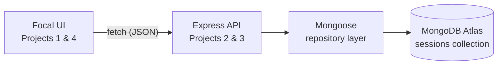

# 🚀 DecodeLabs Full Stack Internship — Task Submissions

**One product, built layer by layer: a responsive front end, a REST API, a MongoDB database, and the integration that connects them.**

> **Full Stack Development Virtual Internship — DecodeLabs (Batch 2026)**  
> Submitted by **Tanya Vaish**


---

# 📖 Overview

This repository contains all task submissions for the **DecodeLabs Full Stack Development internship**. Instead of four unrelated exercises, every milestone builds on the same product — **Focal**, a distraction-free focus timer:

1. The interface was built first (Project 1).
2. A backend API was built to store sessions (Project 2).
3. The API was moved onto a real database (Project 3).
4. The front end was connected to the live API (Project 4).

Each project folder has its own README with setup steps, features, and screenshots.

---

# 📂 Projects

| # | Project | Folder | Stack |
|---|---------|--------|-------|
| 1 | **Responsive Frontend Interface** | [`project-1-responsive-frontend/`](./project-1-responsive-frontend) | HTML5, CSS3, Vanilla JavaScript |
| 2 & 3 | **Backend API Development + Database Integration** | [`project-2-3-backend-database/`](./project-2-3-backend-database) | Node.js, Express, TypeScript, MongoDB Atlas, Mongoose, Zod |
| 4 | **Frontend–Backend Integration** | [`project-4-frontend-backend-integration/`](./project-4-frontend-backend-integration) | Vanilla JavaScript, Fetch API, REST |

> Projects 2 and 3 share one folder because Project 3 extends the same API: the in-memory store from Project 2 was replaced with MongoDB, with no changes to the controller or service layers.

---

# 🌐 Live Links

| What | Link |
|------|------|
| 🖥️ Focal website (Project 1) | https://focal-timer.vercel.app/ |
| ⚙️ Focal API (Projects 2 & 3) | https://focal-api.onrender.com |
| ❤️ API health check | https://focal-api.onrender.com/health |

> **Note:** The API runs on Render's free tier, so the first request after a period of inactivity can take 30–60 seconds while the server wakes up.

---

# 🧩 How the Projects Fit Together



| Layer | Responsibility |
|-------|----------------|
| **Frontend** | Focus timer UI, theme, accessibility; in Project 4 it saves finished sessions and loads today's count from the API |
| **API** | Routes → Controllers → Services → Repository, with Zod validation and centralized error handling |
| **Database** | MongoDB Atlas via Mongoose, with schema validation, an index on `mode`, and injection-safe ID checks |

---

# ✨ Highlights

- ⏱️ A working focus timer (15 / 25 / 50 minutes) with automatic breaks and an animated progress ring
- 🌗 Light and dark mode, mobile-first responsive layout, and accessibility support
- 🧱 Layered backend architecture with full CRUD and a consistent JSON error format
- 🛡️ Two-layer validation (Zod for requests, Mongoose for documents) and NoSQL-injection-safe route parameters
- 💾 Persistent data in MongoDB Atlas that survives server restarts
- 🔌 Front end integrated with the deployed API, with visible loading and error states

---

# 🛠️ Tech Stack

| Category | Technology |
|----------|------------|
| Front end | HTML5, CSS3 (Grid, Flexbox, Custom Properties), Vanilla JavaScript (ES6+) |
| Back end | Node.js, Express.js, TypeScript |
| Database | MongoDB Atlas, Mongoose |
| Validation | Zod (requests) + Mongoose schema (persistence) |
| Tooling | ts-node-dev, ESLint, Prettier, Git & GitHub |
| Hosting | Vercel (front end), Render (API) |

---

# 📁 Repository Structure

```text
decodelabs_tasks/
├── project-1-responsive-frontend/
│   ├── css/
│   ├── js/
│   ├── screenshots/
│   ├── index.html
│   └── README.md
├── project-2-3-backend-database/
│   ├── src/
│   ├── screenshots/
│   ├── .env.example
│   ├── package.json
│   ├── tsconfig.json
│   └── README.md
├── project-4-frontend-backend-integration/
│   ├── css/
│   ├── js/
│   ├── index.html
│   └── README.md
├── .gitignore
└── README.md
```

---

# 🚀 Getting Started

```bash
git clone https://github.com/TanyaVaish-17/decodelabs_tasks.git
cd decodelabs_tasks
```

| To run… | Do this |
|---------|---------|
| **Project 1** | Open `project-1-responsive-frontend/index.html` in a browser (no build step) |
| **Projects 2 & 3** | `cd project-2-3-backend-database` → `npm install` → copy `.env.example` to `.env` and add your MongoDB URI → `npm run dev` |
| **Project 4** | Serve `project-4-frontend-backend-integration/` with VS Code Live Server (port 5500); it talks to the live API by default |

See each project's README for full instructions.

---

# 🎓 What I Learned

- A layered architecture lets one part of a system (like the storage engine) change without rewriting the rest
- Validation belongs at more than one layer, and consistent error responses make a front end much easier to build
- Security has to be considered early — for example by validating route parameters to prevent NoSQL injection
- Accessibility and responsiveness are part of the first build, not extras
- Connecting a front end to a deployed API means planning for CORS, cold starts, loading states, and failures

---

# 👩‍💻 Author

**Tanya Vaish**

Full Stack Development Intern  
DecodeLabs (Batch 2026)

---

⭐ If you found this repository helpful, consider giving it a star!
