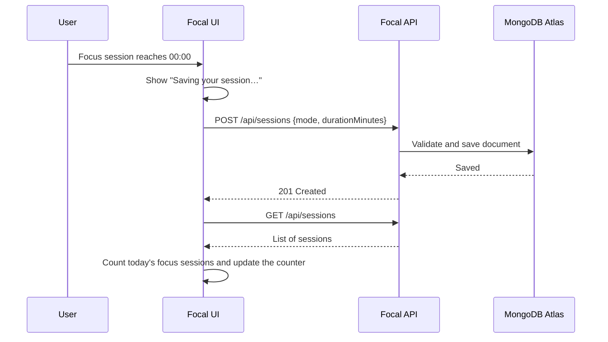

# 🔌 Focal — Frontend–Backend Integration

**The Focal focus timer, connected to a live REST API so every completed session is saved to a database and today's count is loaded from it.**

> **Project 4 — Frontend–Backend Integration**  
> DecodeLabs Full Stack Internship (Batch 2026)


---

# 📖 Overview

In Project 1, Focal was a front-end-only timer that counted sessions in the browser's `localStorage`. In Projects 2 and 3, a separate backend API with a MongoDB database was built to store sessions. **This project joins the two.**

The interface from Project 1 is kept as it was, and a thin API layer is added so that:

- ✅ When a focus session finishes, it is **saved to the database** through the API
- 📊 The "sessions completed today" counter is **loaded from the database**, not from the browser
- ⏳ The user sees a **loading message** while a request is running
- ⚠️ If something goes wrong, the user sees a **clear error message** instead of a silent failure

---

# 🌐 Connected Backend

This front end talks to the **Focal API** built in Projects 2 and 3 (see [`project-2-3-backend-database`](../project-2-3-backend-database)).

**API Base URL**

https://focal-api.onrender.com/api

**Health Check**

https://focal-api.onrender.com/health

> **Note:** The API is hosted on Render's free tier, so the first request after inactivity may take 30–60 seconds. During that time the page shows the "Saving your session…" message, and the request completes once the server has woken up.

---

# ✨ Features

**Carried over from Project 1:**
- ⏱️ Focus timer with 15 / 25 / 50-minute sessions and an animated progress ring
- 🔁 Automatic 5-minute break after each session, 15 minutes after every fourth
- 🌗 Light / dark mode (remembered between visits)
- 📱 Mobile-first responsive layout and accessible markup
- 🧩 Accordion FAQ and animated hamburger navigation

**Added in Project 4:**
- 💾 **Session saving** — each completed focus session is sent to the API with `POST /api/sessions`
- 📊 **Server-backed counter** — today's focus sessions are loaded with `GET /api/sessions` and filtered from local midnight onward
- 🧱 **One reusable request helper** — every API call goes through a single `apiRequest()` function, so error handling and JSON parsing are written once
- 🔔 **Status banner** — an accessible (`role="status"`, `aria-live="polite"`) banner for loading and error messages
- 🛟 **Graceful failure** — if saving fails, the session still counts locally and the user is told why

---

# 🔄 How It Works



When the page first loads, the counter is also filled by a `GET /api/sessions` request, so the number always comes from the database.

---

# 🧯 Error Handling

All requests go through `apiRequest()` in `js/api.js`, which handles three different failure types:

| Situation | What happens |
|-----------|--------------|
| **Network failure** (offline, DNS, CORS block) | `fetch` throws; the helper raises "Network error: could not reach the server" |
| **Error response** (4xx / 5xx) | The helper reads the backend's structured `error.message`; if the body is not JSON it falls back to the status code |
| **No content** (`204`) | Returns `null` instead of trying to parse an empty body |

If saving a session fails, the user sees *"Could not save that session — it still counts locally, but check your connection."* The banner disappears automatically after 5 seconds.

---

# 📡 API Layer

`js/api.js` exposes a small `sessionsApi` object that wraps the backend endpoints:

| Method | Endpoint | `sessionsApi` function | Used by the UI |
|--------|----------|------------------------|----------------|
| GET | `/api/sessions` | `list()` | ✅ Loads today's count |
| POST | `/api/sessions` | `create(session)` | ✅ Saves a finished focus session |
| PUT | `/api/sessions/:id` | `update(id, updates)` | Available for future features |
| DELETE | `/api/sessions/:id` | `remove(id)` | Available for future features |

---

# 🛠️ Tech Stack

| Layer | Choice |
|-------|--------|
| Markup | Semantic HTML5 |
| Styling | CSS3 — Grid, Flexbox, Custom Properties, `clamp()` |
| Behavior | Vanilla JavaScript (ES6+) |
| Networking | Fetch API with `async` / `await` |
| Fonts | Montserrat (display) · Roboto (body) |
| Storage | `localStorage` (theme) + MongoDB Atlas through the API (sessions) |

---

# 📁 Folder Structure

```text
project-4-frontend-backend-integration/
├── index.html
├── css/
│   └── style.css
├── js/
│   ├── api.js        # API base URL, request helper, sessionsApi, status banner
│   └── script.js     # timer, theme, navigation, and API-connected session logic
├── screenshots/
└── README.md
```

---

# 🚀 Installation & Running

No build tools or dependencies — it's a static HTML/CSS/JS project.

```bash
# Clone the repository
git clone https://github.com/TanyaVaish-17/decodelabs_tasks.git

# Navigate into the project
cd decodelabs_tasks/project-4-frontend-backend-integration
```

Then open the folder in **VS Code** and start it with the **Live Server** extension (it serves on port `5500`).

> **Why Live Server?** The backend only accepts requests from approved origins (CORS), and `http://localhost:5500` / `http://127.0.0.1:5500` are on that list. Opening `index.html` directly from the file system will usually be blocked.

### Using a local backend instead

By default `js/api.js` points to the deployed API:

```js
const API_BASE_URL = 'https://focal-api.onrender.com/api';
```

To test against your own server, run the backend from [`project-2-3-backend-database`](../project-2-3-backend-database) and change the value to:

```js
const API_BASE_URL = 'http://localhost:5000/api';
```

---

# 🧭 Usage

1. Choose a focus duration (15, 25, or 50 minutes).
2. Click **Start** and work until the timer reaches zero.
3. The page shows **"Saving your session…"** while the session is sent to the API.
4. The **sessions completed today** counter updates from the database.
5. Focal switches to a break automatically.
6. Refresh the page — the counter stays, because it is loaded from the server.

---

# 🔮 Future Improvements

- 📜 Session history view using the existing `list()` call, with delete support through `remove()`
- 🔁 Retry queue for sessions that fail to save while offline
- 🔐 User accounts with JWT authentication, so each person sees their own sessions
- 📄 Pagination and date-range filtering on the sessions request
- 🧪 Automated tests for the API helper and timer logic

---

# 👩‍💻 Author

**Tanya Vaish**

Full Stack Development Intern  
DecodeLabs (Batch 2026)

---

⭐ If you found this project helpful, consider giving it a star!
